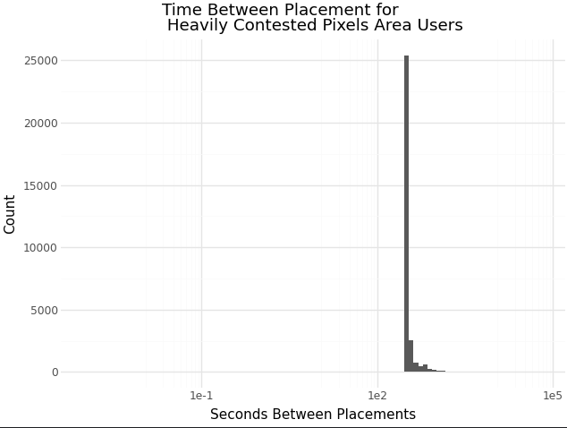
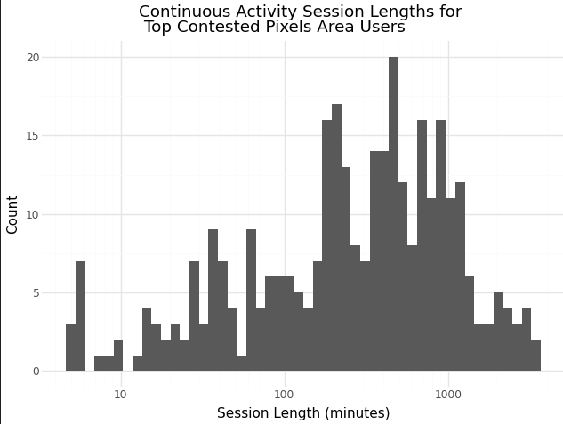
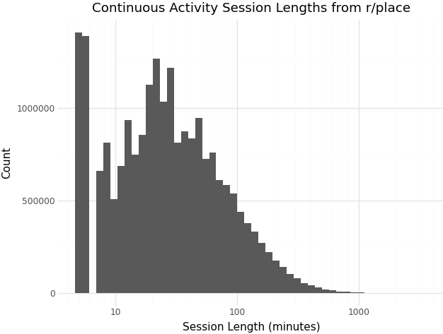
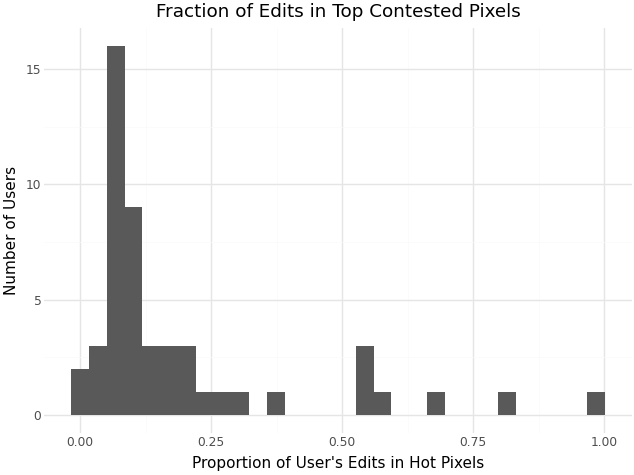
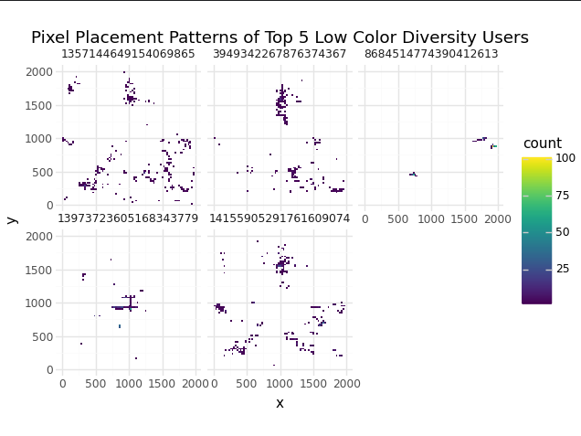
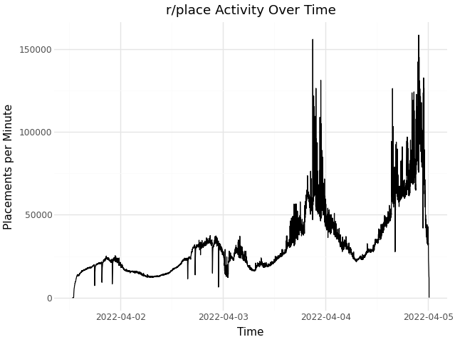
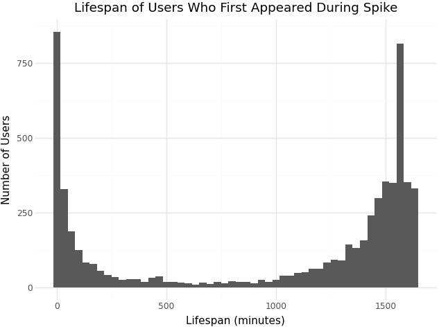
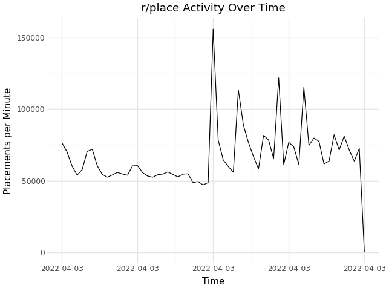
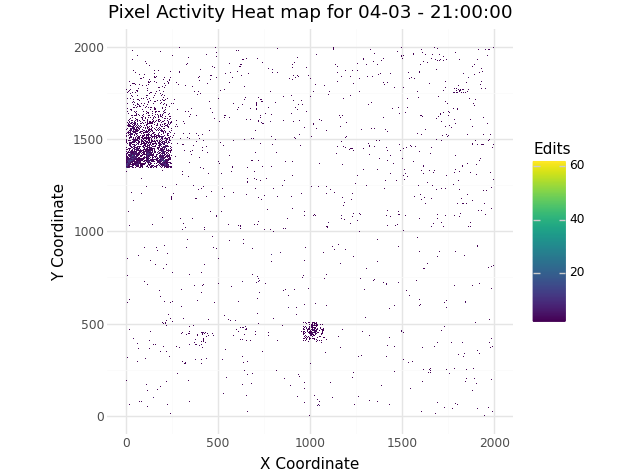
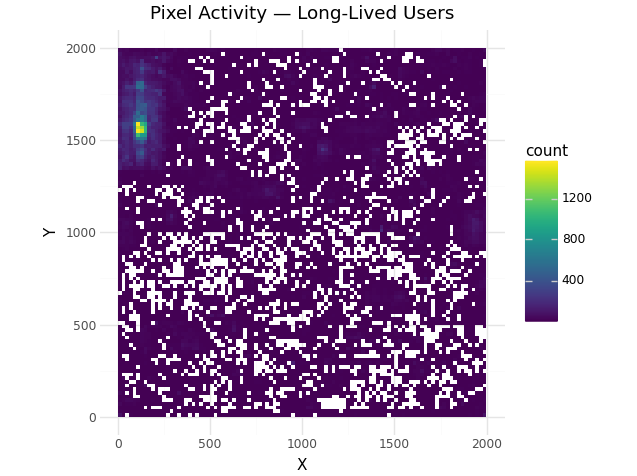

## Bucket 1

### Automated Territorial Defense / Pixel Warfare

#### Human description:

Certain regions of the canvas experienced extreme pixel placement in a specific pixel, with some individual pixels being repainted over 90,000 times. This level of sustained, repetitive activity is suggestive of automated tools or highly coordinated groups defending territory. *(See Bucket_1.py for script)*

Evidence found that the irregular activity could exist:

- Table of top pixels

|   x |   y |   edits |
|----:|----:|--------:|
|   0 |   0 |   98807 |
| 359 | 564 |   69198 |
| 349 | 564 |   55230 |
| 859 | 766 |   52261 |
| 860 | 766 |   51485 |

- Table contains pixels with >50,000 edits

- Top users contributing hundreds of edits to heavily edited pixels (pixels changed more than 100 times) (table evidence):

|     user_id |   edits_on_hot_pixels |
|------------:|----------------------:|
| 5.93665e+18 |                   653 |
| 1.99475e+17 |                   570 |
| 1.10989e+19 |                   554 |
| 1.60994e+18 |                   534 |
| 1.3479e+19  |                   533 |

One caveat for everything below: these 50 users are essentially the most active accounts overall, so long sessions and cooldown-timed placements are partly expected from how they were picked.

#### Time Between Placement Exploration Evidence:

This graph shows the time between placement distribution for users heavily involved in heavily contested pixels shows a sharp spike at a consistent interval, corresponding closely to the platform’s cooldown period. This is consistent with scripted placement timed to the cooldown, though someone placing as soon as the timer resets would produce a similar spike, and I didn't plot regular users for comparison.

#### Session Length Exploration Evidence

This graph shows many of the users responsible for the highest placed pixels remained continuously active for sessions lasting 10–25 hours without breaks longer than 30 minutes. Sessions that long are hard to explain for one person at a keyboard, which makes them suggestive of automation, though this data can't confirm it. Comparing this to a baseline graph of the session length for all r/place users it is clear the session lengths are much higher for the users in the top contested pixel areas than general users.

**Session lengths for heavily contested-pixel users:**

**Session lengths across all r/place users:**

#### Spatial Concentration Exploration Evidence

Looking at edit concentration shows that while many users placed pixels across a wide range of locations, a subset of the users in the high pixel placement areas directed a majority of their activity toward a very small set of heavily contested pixels. In several cases, more than half and sometimes nearly all of a user’s placements occurred in these high placement area regions. This level of spatial focus is consistent with automated or highly coordinated territorial defense, though dedicated human defenders could look similar.

#### Conclusion

Taken together, these behavioral patterns: 

extreme pixel churn, cooldown-synchronized timing, unusually long continuous activity sessions, and highly concentrated spatial focus 

are consistent with automated or highly coordinated territorial defense. Without ground truth on which accounts used scripts, this can't be confirmed.

## Bucket 2  

### Low Color Diversity / Task-Specialized Automation

#### Human description:

A subset of highly active accounts exhibited extremely low color diversity, placing hundreds of pixels while using only one or two colors. Unlike typical participants who switch colors while contributing to artwork, these accounts repeatedly placed the same color. This pattern suggests task-focused, repetitive behavior consistent with automated scripts or tool-assisted placement rather than normal human artistic participation. *(See Bucket_2.py for script)*

Evidence found that the irregular activity could exist:

- Distribution of color diversity ratios per user  
- Table of highly active users with only 1–2 total colors used  
- Per-user spatial maps showing where each account placed pixels  

#### Color Diversity Exploration Evidence:

Looking at per-user color usage shows that several accounts made between 200 and 700 placements while using only one or two colors. These users have color diversity ratios below 0.01 (distinct colors ÷ total placements). Four of the five accounts in the table used a single color for every placement. Table to support:

| user_id              | total_colors | total_edits | color_diversity_ratio |
|----------------------|--------------|-------------|------------------------|
| 13973723605168343779  | 1            | 406         | 0.002463               |
| 1357144649154069865   | 1            | 403         | 0.002481               |
| 8684514774390412613   | 1            | 396         | 0.002525               |
| 14155905291761609074  | 2            | 692         | 0.002890               |
| 3949342267876374367   | 1            | 334         | 0.002994               |

#### Color Dominance Exploration Evidence

For the single-color accounts, every placement was the same color by definition. I didn't measure how the two-color accounts split their placements.

#### Spatial Pattern Exploration Evidence

The maps are mixed. Some accounts stayed in one small area or along a line, which fits repetitive maintenance work, while others placed clusters all over the canvas.

*Figure: Spatial placement patterns for the five most extreme low color-diversity users. Some stayed in one small area or along a line, while others placed clusters all over the canvas.*

#### Conclusion

Low color diversity is suggestive of repetitive, task-focused placement, which could be scripted or just a very focused person. The spatial maps don't settle it either way.

## Bucket 3  

### Mass First-Time User Spike

#### Human description:

During several short time windows, the platform experienced unusually large surges of first-time participants placing their very first pixel. These spikes represent moments where thousands of new accounts became active almost simultaneously. While high activity is expected during major events, the scale and sharpness of these bursts looked like it could be organized influxes of users rather than gradual organic growth. Leading to the hypothesis that this could be due to mass amount of bot users being made to take over a canvas. *(See Bucket_3.py for script)*

### Evidence found that the irregular activity could exist:

- Minute-level placement activity time series showing sharp spikes  
- Table of the highest-activity minutes  
- Table of first-time user counts and statistical comparison  
- Lifespan statistics of users who joined during the spike  

### First-Time User Spike Exploration Evidence

This overall minute-level activity time series shows several sharp placement spikes across the event.

One of the largest spikes occurs at **2022-04-03 21:00**, which appears in the table of top placement minutes. Although this is only the second highest in placements I chose to look into this time because the top one not only had all the other highest placements just less than it but also was right at the end of the r/place timeframe so a super extreme spike would be expected:

| minute              | placements |
|---------------------|-----------:|
| 2022-04-04 21:47:00 |     158506 |
| 2022-04-03 21:00:00 |     155955 |
| 2022-04-04 21:53:00 |     145168 |
| 2022-04-04 21:43:00 |     143402 |
| 2022-04-04 21:37:00 |     142327 |

To determine whether this represented *new participants*, I examined the timestamp of each user’s **first-ever placement**. The spike minute stands out as statistically extreme:

| Spike Minute       | First-Time Users in Spike | Average First-Time Users per Minute | Std Dev per Minute | Z-Score of Spike |
|-------------------|--------------------------:|------------------------------------:|-------------------:|-----------------:|
| 2022-04-03 21:00  |                      5965 |                             2076.23 |            907.051 |          4.28727 |

Nearly **6,000 accounts** placed their first-ever pixel within this single minute, compared to an average of roughly **2,076 new users per minute**. A z-score above **4** makes this a clear outlier compared with a typical minute, which at first seemed to support the bot hypothesis.

### User Lifespan Exploration Evidence

I next examined how long these new users kept placing pixels after their first placement. Lifespan here means the time between a user's first and last placement, not continuous activity. Rather than disappearing immediately, many came back to place pixels much later.

| spike_new_users | avg_lifespan_min | std_lifespan_min | median_lifespan_min | p90_lifespan_min |
|----------------:|-----------------:|-----------------:|--------------------:|-----------------:|
|            5965 |         981.97   |         660.28   |              1364   |            1590  |

On average, their last placement came over **16 hours** after their first (median about 23 hours). This weakened my hypothesis that this irregular event was due to bot activity as if these were all created for just a specific moment not many of the users would have had long lifespans.

### Time-Based Clustering Exploration Evidence

Looking more into this the new user surges occurred in narrow, sharply defined time windows rather than gradually over longer periods.

The rapid rise in first-time user counts suggests a large participation driven by some type of external coordination such as a famous streamer doing an event on r/place or maybe r/place gaining a popular post on some other reddit thread trying to make an image.

A heatmap of pixel placements during the spike minute and then looking at those that stayed for a long time shows that these users contributed broadly across the canvas after this event rather than concentrating in one location the whole lifespan. They went from working on one specific spot where the event was probably focused, then the people that stayed spread out to other parts of the r/place. That makes a simple bot-wave explanation less convincing:

So coordinated human participation is another plausible explanation, though this doesn't prove these accounts were all human.

### Conclusion

These behavioral patterns point toward a large scale external event bringing new participants to the canvas. I decided to include this as a bucket because it looked like bot behavior at first, and it was interesting that the later activity made a simple bot-wave explanation less convincing and coordinated human participation another plausible explanation.
