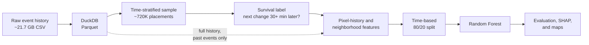
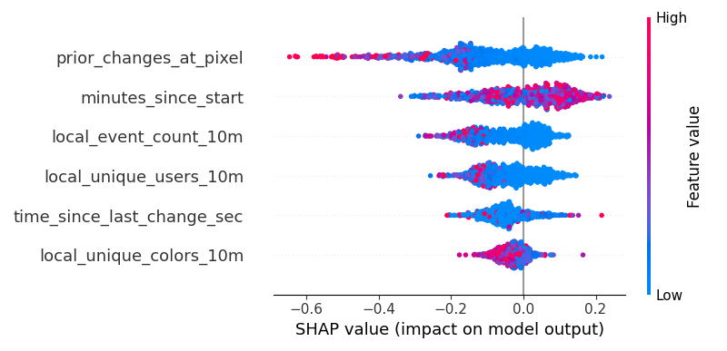
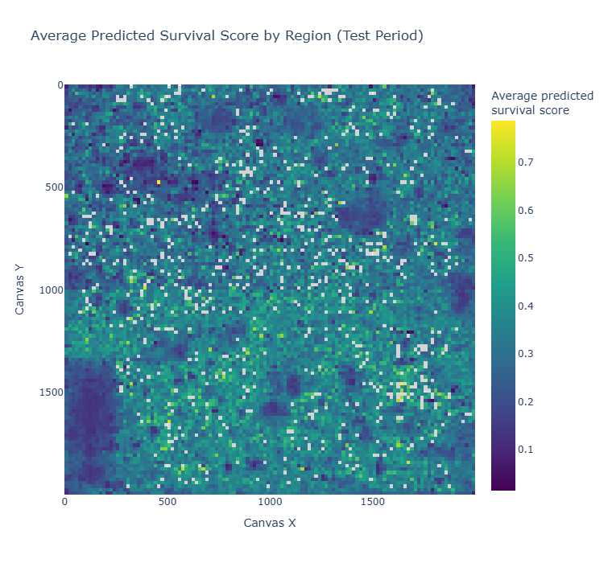

# r/place 2022 Canvas Analytics

Large-scale behavioral analysis and pixel-survival modeling on Reddit's 2022 r/place event.

## What is r/place?

r/place is a shared online canvas run by Reddit. Anyone with an account can place one colored pixel, then has to wait out a cooldown timer before placing another, and anyone else can paint over that pixel at any time. Communities organize to build artwork and defend it from other groups, so the canvas ends up being a record of cooperation, conflict, and timing. The 2022 event ran from April 1 to April 5, and the canvas grew in stages until it reached 2000 × 2000 pixels.

The dataset contains about 160 million recorded pixel placements, each with a timestamp, user ID, color, and coordinates, in a ~21.7 GB CSV. To work with it, I used DuckDB to convert it to a ~2.1 GB Parquet file and ran everything as SQL queries against that file, so the full dataset never had to fit in memory.

## Main Analysis: Can We Predict Whether a Pixel Survives?

**Using only information available when a pixel is placed, can we predict whether it will still be there 30 minutes later?**

Most pixels get painted over quickly (about three-quarters in my sample were overwritten within 30 minutes), but some last for hours. Whether a pixel survives seems like it should depend on things you can measure at the moment it's placed: how contested that spot already is, how recently the pixel changed, how busy the area around it is, and when in the event it was placed. I wanted to see how far those signals actually go.

## How the Model Works

**Sampling.** I sampled about 720,000 placements, 30,000 from each of 24 equal time slices of the event, so the busiest hours wouldn't dominate the data.

**Label.** For each sampled placement, I used `LEAD(ts) OVER (PARTITION BY x, y ORDER BY ts)` on the full dataset to find the next time that same pixel changed. If that was 30 or more minutes later (or never), the placement counts as survived.

**Features built only from the past.** This is the part I was most careful about. Every feature is computed from the full 160 million row history, but only from events *before* the placement, so nothing from the future leaks into the model:

| Feature | What it measures |
|---|---|
| `prior_changes_at_pixel` | How many times this exact pixel had already changed |
| `time_since_last_change_sec` | Seconds since this pixel last changed |
| `local_event_count_10m` | Placements in the same 20 × 20 pixel area in the previous 10 minutes |
| `local_unique_users_10m` | Distinct users in that area in the previous 10 minutes |
| `local_unique_colors_10m` | Distinct colors in that area in the previous 10 minutes |
| `minutes_since_start` | Minutes since the event started |

I left out the x and y coordinates on purpose so the model couldn't just memorize which spots were safe.

**Time-based split.** The earliest 80% of the sample is the training set and the latest 20% is the test set, so the model is always predicting placements that happened after everything it trained on.

**Model.** A Random Forest (150 trees, `class_weight="balanced"` because survivors are the minority), with SHAP values to see what drove the predictions.

## Results

The model picked up some real signal, but it missed most of the pixels that survived.

| Test set (144,069 placements) | Precision | Recall | F1 |
|---|---|---|---|
| Overwritten within 30 min | 0.77 | 0.98 | 0.86 |
| Survived 30+ min | 0.53 | 0.08 | 0.13 |

| | Model | Baseline |
|---|---:|---:|
| Accuracy | 0.766 | 0.764 (always predict overwritten) |
| ROC-AUC | 0.75 | 0.50 |
| Average Precision (survived class) | 0.44 | 0.24 (survivor prevalence) |

At the default 0.5 threshold, the model predicted "overwritten" for almost everything: all but 4,882 of the 144,069 test placements. That's where the 0.98 recall on the overwritten class comes from, and it's why overall accuracy is barely above just guessing "overwritten" every time. Out of the 33,970 placements that actually survived, it caught 2,571.

The scores themselves carry more signal than those predictions show. ROC-AUC is 0.75, and Average Precision (AP) for survivors is 0.44, compared with a survivor prevalence of 0.24 in the test set. When the model does predict survival, it's right 53% of the time, a little more than double that base rate. The [precision-recall curve](pixel_survival_model/images/precision_recall_curve.png) shows the full tradeoff.

So this isn't a strong survival classifier as it stands. The more useful takeaway is which signals matter.

## What Matters Most?

The pixel's own history was the strongest signal. `prior_changes_at_pixel` had the largest average SHAP value (0.14), and pixels that had already changed many times were a lot less likely to survive. Next came `minutes_since_start` (0.09), then recent activity nearby: the number of placements (0.08) and distinct users (0.07) in the same area over the previous 10 minutes. Busier areas pushed predictions toward "overwritten."

I don't read much into the direction of `minutes_since_start`. Because of the time-based split, every test placement happened later than all of the training data, so the model treats them all like the very end of the training period.

## Spatial Patterns

This map shows the **average predicted survival score** for each region of the canvas during the test period (the last 20% of the event). Each cell is about 17 × 17 pixels and averages around 10 test placements, so some cell-to-cell noise is expected, and gray cells had no test placements. These are the model's scores, not observed survival rates, and they aren't calibrated probabilities.

Interactive versions: [heatmap](https://owenloughery.github.io/rplace_2022-canvas-analytics/survival_heatmap.html) · [3-hour scatter map](https://owenloughery.github.io/rplace_2022-canvas-analytics/survival_scatter.html) · [SHAP importance](https://owenloughery.github.io/rplace_2022-canvas-analytics/shap_importance.html)

## Additional Behavioral Analyses

I also used the same dataset for a few smaller exploratory analyses. The full write-up with tables and charts is in the [irregular activity report](Irregular_Activity_Report/report.md).

**Contested pixels and unusual activity.** Some pixels were repainted tens of thousands of times. Pixel (0, 0) alone changed 98,807 times. The most active accounts on these heavily edited pixels mostly placed right at the cooldown interval, some in sessions longer than 10 hours without a 30-minute break. That's consistent with automated or highly coordinated activity, but it can't be confirmed without ground truth.

**Color-use behavior.** A small group of very active accounts placed hundreds of pixels using only one or two colors. One account placed 406 pixels, all the same color. Where they placed them varied: some stayed in one small area, others spread out across the canvas.

**A surge of first-time users.** In one minute (April 3 at 21:00 UTC), 5,965 accounts placed their first-ever pixel. That's 4.3 standard deviations above the average of 2,076 first-time users per minute. It looked like it might be a wave of bot accounts, but for half of these accounts the last placement came more than 22 hours after the first, and their pixels ended up all over the canvas. That made a simple bot-wave explanation less convincing and pointed toward coordinated human participation as another plausible explanation.

## Data Engineering

- Converted the ~21.7 GB CSV to a ~2.1 GB ZSTD-compressed Parquet file with DuckDB, hashing user IDs and splitting coordinates into integer `x` / `y` columns.
- Ran every analysis as DuckDB SQL directly on the Parquet file.
- Built the survival label and pixel-history features with window functions (`LEAD`, `LAG`, `ROW_NUMBER`) partitioned by pixel across all 160 million placements.
- Built the neighborhood features with a time-bounded join: each sampled placement matched to every placement in its 20 × 20 area during the 10 minutes before it.

## Limitations

- **Imbalanced classes and the default threshold.** Only about a quarter of placements survived. At the default 0.5 threshold the model misses most survivors, and its accuracy is about the same as always guessing "overwritten."
- **Time on the test set.** Every test placement is later than all of the training data, so `minutes_since_start` can't be interpreted normally there.
- **End of the dataset.** Placements near the very end that were never changed again are labeled as survivors, even if fewer than 30 minutes were left.
- **Same-color re-placements.** Placing the same color on a pixel again still counts as an overwrite.
- **Equal sampling across time.** Taking 30,000 placements from each time slice over-represents quiet hours compared with the real event.
- **Unseeded sample.** The sample was drawn with `random()` and no seed, so rerunning the sampling step gives a slightly different sample.
- **No ground truth for automation.** The behavioral analyses can show patterns consistent with scripts, but they can't confirm them.
- **Maps show model scores.** Not observed survival rates.

## Technical Stack

Python · DuckDB · SQL · Parquet · pandas · NumPy · scikit-learn · SHAP · Plotly · plotnine · GitHub Pages

## Repository Guide

| Folder | What's in it |
|---|---|
| [`pixel_survival_model/`](pixel_survival_model/) | **Main analysis.** Sampling ([`SamplePreprocess.py`](pixel_survival_model/SamplePreprocess.py)), labels and features ([`TrainingPreprocess.py`](pixel_survival_model/TrainingPreprocess.py)), model, SHAP, and maps ([`research.py`](pixel_survival_model/research.py)), full evaluation ([`evaluate.py`](pixel_survival_model/evaluate.py), saved to [`results/evaluation.json`](pixel_survival_model/results/evaluation.json)), plus a [detailed write-up](pixel_survival_model/README.md) |
| [`Irregular_Activity_Report/`](Irregular_Activity_Report/) | Exploratory analyses of contested pixels, color use, and the first-time user surge, with the full [report](Irregular_Activity_Report/report.md) |
| [`Preprocessing_Basic_Analysis/`](Preprocessing_Basic_Analysis/) | CSV to Parquet conversion ([`preprocess.py`](Preprocessing_Basic_Analysis/preprocess.py)) and summary stats for one 6-hour window ([`analysis.py`](Preprocessing_Basic_Analysis/analysis.py)) |
| [`docs/`](docs/) | Interactive Plotly maps, published with GitHub Pages |

To run it yourself: download the 2022 r/place canvas history CSV, install dependencies with `pip install -r requirements.txt`, run `Preprocessing_Basic_Analysis/preprocess.py` to create `place_preprocessed.parquet`, then run the scripts in each folder with that Parquet file in the working directory.
