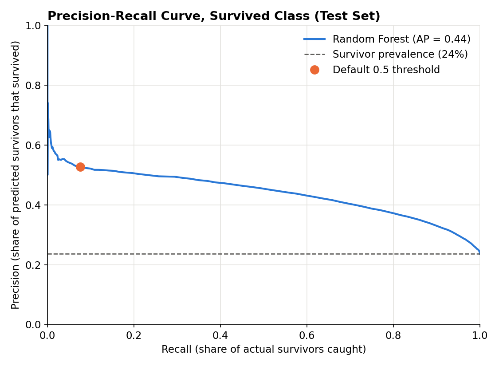
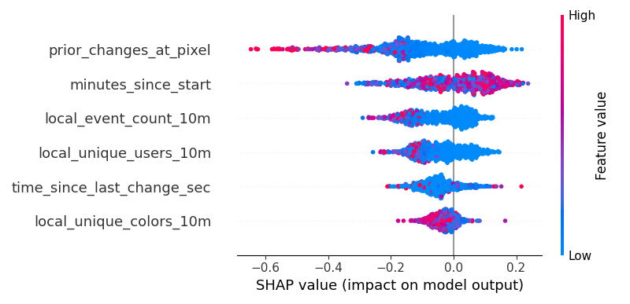
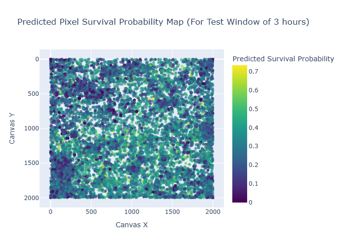
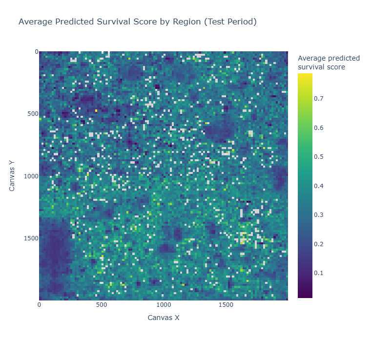

# Analysis — Predicting Pixel Survival

## Quick Analysis Overview

This is the main analysis of the project: predicting whether a pixel placement survives for at least 30 minutes. 

### What’s included
- `SamplePreprocess.py` - the preprocessing for the sample dataset made
- `TrainingPreprocess.py` - the preprocessing for the training and testing datasets
- `research.py` - building my ML model and making the visualizations to describe my findings
- `evaluate.py` - a fuller evaluation of the same model (baseline, ROC-AUC, Average Precision, precision-recall curve), saved to `results/evaluation.json`

So now let's go into what I actually decided to do for this analysis!

## What I did
I trained a machine learning model to predict whether a pixel placement in r/place 2022 would **survive at least 30 minutes** (not be overwritten). The model picked up some real signal, but it missed most of the pixels that actually survived. Using SHAP for interpretation, the strongest predictors of survival were:

- **How many times that pixel had already been changed** (high = much less likely to survive)
- **When in the event the pixel was placed** (see the note below on how to read this one)
- **How active the local area was in the last 10 minutes** (more activity/users = less likely to survive)

The reason I chose to build this model and look into this was to build a method so that in the r/place if this event were hosted again, you could find what areas of the canvas would give you the best chance at creating an artwork on your own or just with a smaller community by using the model.

## Research Question
**Can we predict whether a pixel will survive for 30 minutes, using only information available at the moment it was placed?**

### Why this is interesting
r/place looks like a chaotic and very random thing, but it’s also a system of coordinated behavior. If survival is predictable, that implies there are measurable “rules” to stable places (quiet zones, defended regions) versus conflict areas (borders, mass scale community takeovers, ongoing battles between communities).

## Method Overview

### Prediction target (label)
For each pixel placement event, I labeled whether it **survived 30 minutes**:

- **1** = survived ≥ 30 minutes before being overwritten  
- **0** = overwritten within 30 minutes  

To compute this, I used LEAD(ts) over (x,y) to find the next time the same pixel was changed.

## Sampling Strategy
The full dataset is huge and is too big to all be used in a ML algorithm, so I used **stratified sampling across time**:

- I divided the event into **24 equal time bins**
- I sampled an equal number of events from each bin to make a total sample size of **720,000**

This keeps the busiest hours from dominating the sample so the model sees the whole event. The tradeoff is that quiet hours are over-represented compared with the real event.

## Feature Engineering
All features were computed using only information from **before** the pixel placement time to make sure there was no future peeking. Also I did not include the actual coordinates x and y in the features because I did not want the model to just memorize pixels and instead be able to predict based on what actually makes the pixel survivable or not.

For each sampled pixel placement, I computed:

### 1) Pixel history features (exact same location)
- **prior_changes_at_pixel**: how many times this pixel had been changed before  
- **time_since_last_change_sec**: seconds since the previous change at the same (x,y)

I decided to use these features since pixels on borders and conflict zones get overwritten repeatedly whereas stable/safe pixels change rarely.

### 2) Local neighborhood activity (approximate region)
To approximate a neighborhood (area in canvas of pixels grouped together), I assigned each pixel to a grid cell:

- gx = floor(x/20)  
- gy = floor(y/20)

Then I measured activity in the same cell during the **previous 10 minutes**:

- **local_event_count_10m**: number of placements nearby  
- **local_unique_users_10m**: number of unique users nearby  
- **local_unique_colors_10m**: number of unique colors nearby  

I chose these features because I thought high activity and many users/colors would indicate conflict (lower pixel survivability).

### 3) Global time feature
- **minutes_since_start**: minutes since the dataset start  

I chose to make this feature since I figured the early event is more chaotic whereas later event stabilizes.

## Train/Test Split (80/20 split)
To avoid data leakage and mimic real prediction, I split by time:

- first **80%** of sampled events (earlier timestamps) = **train**  
- last **20%** (later timestamps) = **test**

This evaluates whether the model can generalize from earlier event behavior to later event behavior.

## Model Choice
I used a **Random Forest classifier** because:

- The r/place dynamics are nonlinear  
- Random forests work well on structured input data features  
- It usually does well without much tuning

I used **class_weight = "balanced"** because survival is less common than overwriting as I found in my training data set there was roughly 75% of the pixels not having survived while only 25% had survived so this was an unbalanced data set.

## Results

### Model performance

Here are the **precision, recall, and f1-score for each class**:

| Class | Meaning | Precision | Recall | f1-score |
|------|---------|-----------|--------|--------|
| 0 | Pixel overwritten | 0.77 | **0.98** | 0.86 |
| 1 | Pixel survived ≥30 min | 0.53 | **0.08** | 0.13 |

At the default 0.5 threshold, the model predicted "overwritten" for almost everything: all but 4,882 of the 144,069 test placements. That's where the 0.98 recall on the overwritten class comes from, and it's why overall accuracy is barely above just guessing "overwritten" every time. Out of the 33,970 placements that actually survived, it caught 2,571.

The scores themselves carry more signal than those predictions show. ROC-AUC is 0.75, and Average Precision (AP) for survivors is 0.44, compared with a survivor prevalence of 0.24 in the test set. When the model does predict survival, it's right 53% of the time, a little more than double that base rate. The precision-recall curve below shows the full tradeoff.

So this isn't a strong survival classifier as it stands. The more useful takeaway is which signals matter.

### Full evaluation

`research.py` only printed the classification report, so I added `evaluate.py`. It retrains the exact same model (same data, features, settings and `random_state`, default 0.5 threshold, no tuning) and saves everything to [`results/evaluation.json`](results/evaluation.json). It reproduces the numbers above exactly.

| | Model | Baseline |
|---|---:|---:|
| Accuracy | 0.766 | 0.764 (always predict overwritten) |
| ROC-AUC | 0.75 | 0.50 |
| Average Precision (survived class) | 0.44 | 0.24 (survivor prevalence) |

Confusion matrix (test set, 144,069 placements):

| | Predicted overwritten | Predicted survived |
|---|---:|---:|
| **Actually overwritten** | 107,788 | 2,311 |
| **Actually survived** | 31,399 | 2,571 |

The curve stays above the survivor prevalence line the whole way, so the scores do rank survivors ahead of overwritten pixels. The orange dot is where the default threshold lands: decent precision, very low recall.

To rerun it: `python evaluate.py <folder with train.parquet and test.parquet>`

## Interpretation with SHAP

To understand what the model learned, I used **SHAP** values. The first image shows direction and second interactive one shows overall feature importance (click on link for second image to view)

### SHAP feature importance

**[View Interactive SHAP Plot](https://OwenLoughery.github.io/rplace_2022-canvas-analytics/shap_importance.html)**

### Direction of effects

- High **prior changes** = strongly decreases survival probability  
- High **local activity** and many **users** = decreases survival probability  
- Time since last change has a mixed effect.  

I don't read much into the direction of `minutes_since_start`. Because of the time-based split, every test placement happened later than all of the training data, so the model treats them all like the very end of the training period.

**Key behavioral conclusion:**  
Pixels placed somewhere that has already been repainted a lot, or where there's a lot going on nearby, are less likely to last.

## Maps of Model Scores

I mapped the model's predicted survival scores onto the canvas (click on the interactive versions to zoom into certain areas):

- A **scatter map** of predicted survival scores for a 3-hour window in the test period

**[View Interactive Scatter Map](https://OwenLoughery.github.io/rplace_2022-canvas-analytics/survival_scatter.html)**

- A **binned heatmap** showing the average predicted survival score by region

**[View Interactive Heatmap](https://OwenLoughery.github.io/rplace_2022-canvas-analytics/survival_heatmap.html)**

The heatmap covers the test period (the last 20% of the event). Each cell is about 17 × 17 pixels and averages around 10 test placements, so some cell-to-cell noise is expected, and gray cells had no test placements. These are the model's scores, not observed survival rates, and they aren't calibrated probabilities.

## Practical Takeaway

If I were trying to make art that lasts, the clearest thing this model points to is avoiding pixels that have already been fought over and areas with a lot of recent activity. It isn't accurate enough to pick out safe spots on its own.
